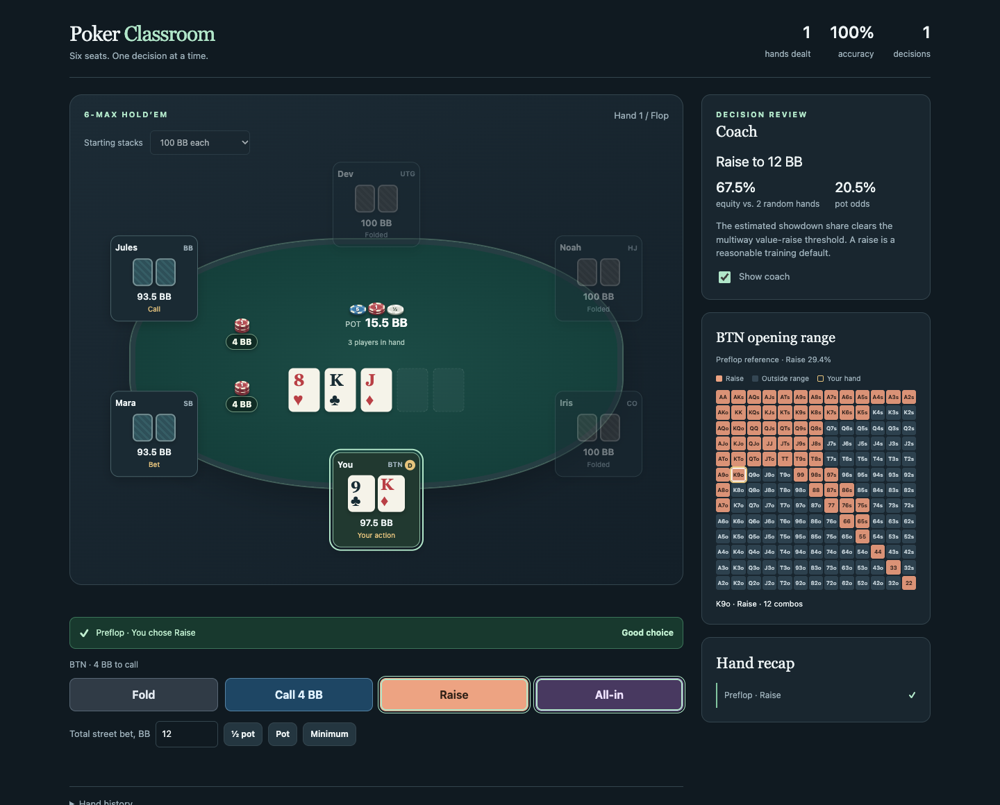

# Poker Classroom

A six-player no-limit Texas Hold’em trainer that runs in your browser.
Practice against five computer opponents and get feedback on your decisions.



## Run

Requires Node.js 20 or newer. From the project folder, run:

```sh
npx serve .
```

Open the local address printed in the terminal.

## Test

From the project folder, run:

```sh
npm test
```

Tests use Node’s built-in test runner; no package installation is needed.

[MIT license](LICENSE).

## Playing and reviewing a session

Select a preset or enter a total street bet, then confirm with Bet/Raise. Unopened
preflop pots default to 2.5 BB; unopened flop bets to 50% pot; turn and river bets
to 75% pot. All-in is a sizing option. Presets respect the legal betting limits.

Use Esc to fold, Space to check/call, and Enter to bet/raise. After a hand ends,
any of those keys deals the next hand. Shortcuts pause while editing inputs or
using other controls. The header sound toggle mutes decision feedback and
remembers the preference. Phone layouts hide the keyboard hints.

Expand Hand history to read or copy the current hand, export all saved histories
as one text file, or reset the session after confirmation. Session histories and
scores are saved in this browser. Exports include the current hand even if it
is still in progress. Reset clears the session but preserves sound, coach, and
stack preferences.

## Simulate and export hands

```sh
npm run simulate
```

Runs 1,000 seeded hands through the current Trainer. The You seat follows the
coach recommendation; opponents retain the app's policy and random behavior.
Requests the app's default 160 equity samples, with adaptive effort for close
decisions and exact heads-up river enumeration (opponents use 53). Rotates the button,
and alternates equal and mixed starting stacks, resetting stacks each hand.

Writes individual PokerStars-style text histories and `summary.json` to
`evals/latest/`. Stakes are synthetic $0.50/$1.00 (one BB = $1), with no rake.
Histories include actions, board runouts, uncalled returns, showdowns, side-pot
payouts, and summaries. Opponent cards appear only at showdown; folded cards
remain hidden. A fixed timestamp makes exports reproducible. Import into
third-party poker tools has not been verified.

For another run, supply hand count, seed, and a new output folder:

```sh
npm run simulate -- 1000 42 evals/seed-42
```

Existing output folders are rejected to preserve previous results. Every hand
must finish, conserve chips and all 52 cards, and balance pot payouts. These
checks evaluate engine consistency, not strategic quality; coach agreement
cannot independently validate the coach's strategy.

### Independent history review

With Python 3 installed, audit the exported files without importing the game
engine:

```sh
python3 scripts/review-histories.py
python3 -m unittest discover -s tests -p test_history_audit.py
```

The audit writes `evals/latest/review/audit.json`. It checks betting legality,
action order, visible cards, independently ranked showdowns, and payouts, and
lists strategy candidates for qualitative review. A candidate is not a proven
strategy error. Local ChatGPT review artifacts from the initial run, when present, live in
`evals/latest/review/`. They are generated results and are not required for tests.

## Range-aware coach

The coach now estimates opponent ranges from public betting history and compares
river fold, call/check and raise values. It checks tighter and looser range
assumptions, tests a caller who folds less often and ranges with more strong
made hands on the river, and marks close decisions as “Both reasonable.”
Opponents use a separate equity-based strategy.
Raise sizes must improve on passive play across the tested models before the
coach recommends them. Preflop decisions facing reraises use more samples and
range sensitivity checks. Sessions save the current hand, scores and history
in this browser.

```sh
npm run eval:coach
```

This evaluates 34 public decision cases and writes
`evals/coach/review-case-results.json`. Cases cover river sizing, showdown value,
strong-made-hand ranges and preflop uncertainty. They are review judgments,
not solver answers.

See [coach policy and limitations](docs/coach-policy.md) for range assumptions,
river response modeling, and validation details.

## Evaluation workflow for future changes

See [the evaluation runbook](docs/evaluations.md) for fresh-checkout commands,
before/after comparisons, decision cases, review criteria, exit statuses and
what to commit. Bulk run outputs stay in the ignored `evals/` folder.
